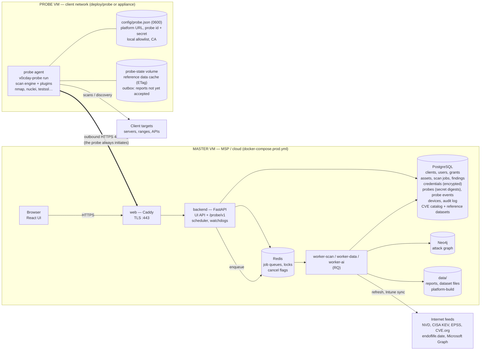
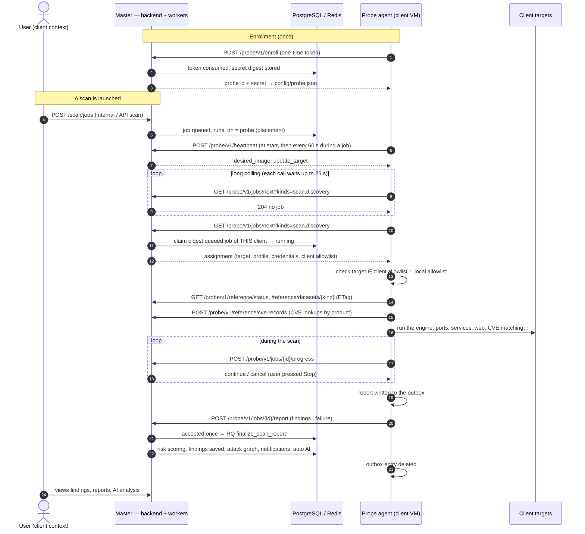

<p align="center">
  
</p>

<h1 align="center">v0cday Platform</h1>
<p align="center">
  <strong>Risk-Based Vulnerability Management — self-hosted, AI-augmented, MIT-licensed</strong>
</p>
<p align="center">
  <a href="#features">Features</a> &bull;
  <a href="#quick-start">Quick Start</a> &bull;
  <a href="#multi-client-msp-and-root">MSP &amp; Root</a> &bull;
  <a href="#scan-probes">Scan Probes</a> &bull;
  <a href="#master--probe-data-flow">Master ↔ Probe flow</a> &bull;
  <a href="#host-discovery">Host Discovery</a> &bull;
  <a href="#device-inventory-microsoft-intune-via-entra-id">Intune / Entra ID</a> &bull;
  <a href="#scanner-plugins">Plugins</a> &bull;
  <a href="#threat-intelligence">Threat Intel</a> &bull;
  <a href="#ai-deep-analysis">AI Analysis</a> &bull;
  <a href="#changelog">Changelog</a>
</p>

---

## Overview

v0cday is a self-hosted Risk-Based Vulnerability Management (RBVM) platform built for security teams and **MSPs**. It combines automated scanning with multi-provider AI analysis to **find**, **validate**, **prioritize**, and **remediate** vulnerabilities across networks, web apps, APIs, IoT, cloud infrastructure, infrastructure-as-code and managed device fleets — for one organisation or for many clients from a single platform.

**v4.0.0 highlights** *(2026-11-27)* — see [Changelog](#changelog) for full notes.

| | |
|---|---|
| 🏢 **Multi-client (MSP)** | Each client is an isolated tenant (assets, scans, findings, devices, reports, settings, integrations). Users reach clients through **grants** (per user or user group, on a client or a client group) with a role per client: `admin`, `analyst`, `viewer` |
| 🪟 **Context window & Root** | After sign-in, a FortiManager-like window lists the clients as tiles (role, open critical/high, KEV, last scan) — plus **Root** for super admins: overview of every client, clients & access, scan probes, shared reference data, Threat Intel, updates & system |
| 📡 **Scan probes** | A VM in the client's network runs its internal/API scans and host discoveries. It **only connects out** (HTTPS 443) — the client opens no port. Install from source or as a self-enrolling **appliance** (OVA / VHDX / qcow2) with signed image updates |
| 🔄 **Probe updates from Root** | *Check for updates* / *Update* moves source-installed probes to the platform's commit; a host-side updater rebuilds, health-checks and rolls back on failure |
| 🔎 **Host discovery on the probe** | Discover a private range from the client's own network, as a cancellable job the page follows live; add hosts to an asset folder as named targets |
| 💻 **Device inventory (Intune via Entra ID)** | Read-only connection to Microsoft Intune through an Entra ID app registration: fleet inventory, OS/app support & update audit, CVE/KEV matching, alerts on new issues only |
| 🔐 **Production stack** | `docker-compose.prod.yml`: Caddy as the only entry point (HTTPS 443), databases unreachable from the network, Redis password, API that refuses to start with default secrets |

**Key capabilities:**
- **71 scanner plugins** (64 built-in + 7 external tools) spanning network / web / infrastructure / IoT / cloud / API / recon / audit
- **MSP multi-client** with per-client RBAC, per-client scan allowlist, audit log per account and client, full client deletion
- **Remote scan probes** per client — outbound-only, enrolled with a one-time token, monitored (offline alerts, versions, history), updatable from Root
- **Microsoft Intune device inventory** through an **Entra ID** application (Graph API, read-only)
- **Multi-provider AI analysis** (Azure OpenAI, Claude CLI, Gemini) for finding validation, attack-chain analysis, and PoC generation — optionally two-staged, so exploit work is spent only on findings that survived validation
- **Shared threat intelligence** (NVD full history, CVE.org, CISA KEV, EPSS, CMS-CVE, Compliance) — one copy for every client, refreshed by super admins
- **Composite threat-score prioritization** beyond CVSS-only — uses EPSS percentile, KEV listing, and ransomware status
- **Compliance mapping** to NIST 800-53, PCI DSS v4, CIS Controls v8, ISO 27001
- **Neo4j attack graph** for visualizing exploit paths
- **No phone-home, no telemetry, no third-party data residency**

---

## Features

| Category | Details |
|----------|---------|
| **Scan engine** | Plugin-based, dependency-resolved, artifact pipeline; per-plugin timeouts; global scan budget; 7 integrated external tools; 70 total plugins |
| **Network** | TCP port discovery (top 100 / 1000 / full), **Nmap** service detection, **UDP** with protocol probes, DNS enum, TLS analysis, CT logs |
| **Web application** | OWASP Top 10 (2025), advanced XSS, deep SQLi, deep OS command injection, SSTI, LFI/RFI, CRLF, host-header, SSRF, open-redirect, LDAP/NoSQL injection |
| **Authenticated web** | Form login + CSRF, bearer, basic, cookie, header — with login-form inspector + Test Login pre-flight |
| **API security** | OpenAPI / Swagger / Postman ingestion + 15 sub-checks (BOLA, mass-assignment, excessive-data, type-confusion, spec-hygiene, GraphQL) |
| **Infrastructure** | SSH audit, SMB, SNMP, FTP anonymous, Redis no-auth, Docker API, Kubernetes API |
| **IoT** | MQTT anonymous access, topic enumeration, publish injection |
| **Cloud** | S3 / GCS / Azure Blob misconfiguration |
| **IaC** *(v3.0)* | Terraform, Dockerfile, Kubernetes, docker-compose, CloudFormation, Helm — 30+ rules |
| **CVE matching** | NVD CPE matching, CMS-specific CVEs, package-based CVE detection, endpoint probes |
| **Threat Intel** *(v3.0)* | Unified CVE view fusing NVD + EPSS + CISA KEV with composite threat score |
| **Enrichment** | Multi-source CVSS (NVD + CNA/ADP), EPSS exploit probability, ransomware-known flag |
| **Prioritization** | CISA KEV cross-reference, EPSS percentile, asset criticality, SLA tracking |
| **Compliance** | NIST 800-53, PCI DSS v4, CIS Controls v8, ISO 27001 mapping with framework presets |
| **Recon** *(v3.0.5)* | Wayback URL discovery, subdomain takeover detection, GitHub secret scan, DNS history / passive DNS, web service metadata capture |
| **SCA** *(v3.0.5)* | Exposed dependency manifests (package.json, requirements.txt, pom.xml, etc.) + 33 known vulnerable packages |
| **TLS Grading** *(v3.0.5)* | A+ through F grade — TLS version, cipher strength, forward secrecy, HSTS, certificate validity |
| **Analytics** *(v3.0.5)* | Executive dashboard, vulnerability trending, scan diff/delta, comparative reports, re-verification scans, auto asset discovery |
| **Reporting** | CSV / HTML / PDF — per host, bulk, or AI-generated narrative reports |
| **AI Analysis** | Multi-provider validation, attack chain identification, per-finding PoC scripts |
| **Datasets** | One-click refresh from NVD / CISA / EPSS / CVE.org; offline upload supported |
| **Graph** | Neo4j attack-path visualization |
| **Integrations** | Slack, Microsoft Teams, generic webhook, SMTP email — with Test buttons that actually work |
| **Multi-client (MSP)** | Client = isolated tenant; clients groups, user groups, grants with a role per client; super admins; context window; Root console |
| **Scan probes** | Outbound-only agent per client site; per-client placement of scan types; appliance with cosign-signed image updates; offline alerts; updates from Root |
| **Host discovery** | Private-range discovery run by the client's probe (TCP connect, 256 addresses per wave, cancel, time budget); hosts added to folders as named targets |
| **Device inventory** | Microsoft Intune via an Entra ID app: devices + installed apps, change journal, OS/app support & update audit, CVE + KEV matching, device pages, alerts |
| **Production** | Caddy (Let's Encrypt or internal CA), HSTS/CSP, no exposed DB, startup safety checks, GitHub self-hosted runner deployment |

---

## Architecture

The **master** (the platform) holds every piece of data and the web UI. A
**probe** per client site only executes jobs and sends results back.

```
                         Internet / MSP network
  ┌──────────────────────────── MASTER VM (docker-compose.prod.yml) ────────────────────────────┐
  │                                                                                             │
  │  Browser ──HTTPS 443──▶ ┌────────────────┐                                                  │
  │  Probes  ──HTTPS 443──▶ │  web (Caddy)   │  TLS, static React UI, reverse proxy             │
  │                         └───────┬────────┘                                                  │
  │                                 ▼                                                           │
  │                         ┌────────────────┐      ┌──────────────┐  ┌───────────────┐         │
  │                         │ backend        │─────▶│ worker-scan  │  │ worker-ai     │         │
  │                         │ FastAPI + API  │ RQ   │ worker-data  │  │ (AI analysis) │         │
  │                         │ /probe/v1      │      └──────┬───────┘  └──────┬────────┘         │
  │                         │ scheduler      │             │                 │                  │
  │                         └──┬────┬────┬───┘             │                 │                  │
  │                            ▼    ▼    ▼                 ▼                 ▼                  │
  │                   PostgreSQL  Redis  Neo4j   ◀─────────┴─────────────────┘                  │
  │                   (all data)  (queues, (attack                                              │
  │                                locks)   graph)   ──HTTPS──▶ NVD, CISA, EPSS, CVE.org,       │
  │                                                             endoflife.date,                 │
  │                                                             Microsoft Graph (Intune)        │
  │                                                                                             │
  └─────────────────────────────────────────────────────────────────────────────────────────────┘
                 ▲ outbound HTTPS 443 only (initiated by the probe)
                 │
  ┌──────────────┴──── PROBE VM (client network, deploy/probe) ────┐
  │ probe container (network_mode: host, NET_RAW)                  │
  │ same scan engine + plugins + external tools as the master      │──▶ client targets / ranges
  └────────────────────────────────────────────────────────────────┘
```

See [Master ↔ Probe data flow](#master--probe-data-flow) for what is stored
where and how the two dialogue.

In the **development** stack (`docker-compose.yml`) the Vite dev server serves
the UI on 5173 and the API listens on 8888; databases are bound to
`127.0.0.1` only.

**Tech stack:** Python 3.11 · FastAPI · SQLAlchemy 2.0 · Redis + RQ · PostgreSQL 16 · Neo4j 5 · React + Vite · Caddy · Nmap · Nuclei · testssl.sh · ffuf · subfinder · httpx · sqlmap · Packer + cosign (appliance)

---

## Quick Start

### Requirements

- Docker
- Docker Compose
### Installation

```bash
git clone https://github.com/Tompr1/VulnScan.git
cd VulnScan
./bootstrap.sh
```
> ⚠️ If your server/linux via VMWare you must change the value from "dev": "vite" to "dev": "node node_modules/vite/bin/vite.js" at frontend/package.json. if not, your frontend not visible

### Access (development stack)

| Service | URL |
|---------|-----|
| **Web UI** | `http://localhost:5173` |
| **API** | `http://localhost:8888` |
| **Neo4j Browser** | `http://localhost:7474` |

**Default credentials** (bootstrap account, created once on an empty database,
from `DEFAULT_ADMIN_EMAIL` / `DEFAULT_ADMIN_PASSWORD`; defaults
`admin@local` / `admin123`). This account is a **super admin**.

> ⚠️ Change the default password after first login, then blank `DEFAULT_ADMIN_PASSWORD` in `.env`.

### After install

1. Sign in: the **context window** opens — choose **Root**.
2. **Root → Reference data → Refresh All** — pulls NVD + CISA KEV + EPSS feeds, shared by every client (faster with `NVD_API_KEY`). Optionally enable the scheduled refresh in **Root → Updates & system**.
3. **Root → Clients & access** — create your clients, users, groups and grants.
4. *(Optional)* **Root → Scan probes** — create a probe for a client and enroll its VM ([Scan Probes](#scan-probes)).
5. Switch to a client (top bar), set its **scan allowlist** (`PUT /settings/allowlist` as a client admin — no screen yet), create a scan profile under **Profiles**, then launch a scan from **Scan Jobs**.

### Production

`docker-compose.yml` is the **development** stack (Vite dev server, source
mounted, `--reload`). In production use `docker-compose.prod.yml`: HTTPS on
443 through Caddy as the only entry point, databases unreachable from the
network, Redis with a password, and an API (`APP_ENV=production`) that refuses
to start with a default secret or password, `CORS_ORIGINS=*`, a non-HTTPS
`PUBLIC_URL` or `PROBE_REQUIRE_HTTPS=false` — see
[`deploy/master/README.md`](deploy/master/README.md):

```bash
DEPLOY_STACK=prod PUBLIC_HOST=soc.example scripts/deploy.sh "$PWD"
```

`CADDY_TLS` selects the certificate: your e-mail for **Let's Encrypt**
(public domain), or `internal` (default) for Caddy's own CA — give its root
certificate to the probes (`--ca-bundle`). Open 443 (and 80 for the
redirect / ACME) only. UI and API are then at `https://<PUBLIC_HOST>`.

---

## Application Menu

The app works in **one context at a time**: a client, or Root. The context
window opens after sign-in and from the top bar (an account with a single
client and no Root goes straight in). URLs carry the context:
`#/c/<client id>/<page>` or `#/root/<page>`.

### Client context

| Section | Page | Purpose |
|---------|------|---------|
| **Overview** | Dashboard | Posture overview, recent activity, Threat Intel band |
| **Scanning** | Assets | Folders, sub-folders and hosts (named targets), scan history rollups, *Scan* on a target |
|  | Devices | Intune device inventory: fleet most exposed first, Intune connections, device pages |
|  | Scan Jobs | Live + historical jobs with progress tracking — shows which probe ran a job |
|  | Profiles | Reusable scanner configurations (plugins + SSH credentials) |
|  | Reports | Generated reports + report templates |
| **Intelligence** | Threat Intel | Fused NVD+EPSS+KEV CVE view with threat scoring (shared data) |
|  | Attack Graph | Neo4j attack paths of the client |
|  | Analytics | Executive dashboard, trending, scan diff, **host discovery** (via the probe), re-verification |
| **Configuration** | Credentials | Encrypted storage for SSH keys, passwords, API tokens |
|  | Settings | *(client admins only)* users of the client, integrations, notifications, SLA presets, automation |

### Root context (super admins)

| Page | Purpose |
|------|---------|
| **Overview** | Every client at a glance, worst first; probes card |
| **Clients & access** | Clients, client groups, users, user groups, grants, super admins; *Why?* drawer explaining a user's effective access; client deletion |
| **Scan probes** | Probes per client, enrollment tokens, appliance first-boot configuration, where each client's scans run, history, *Check for updates* / *Update* |
| **Reference data** | Shared datasets (NVD, CVE.org, KEV, EPSS, CMS-CVE, Compliance): refresh, upload, enable |
| **Threat Intel** | Same shared CVE view, outside any client |
| **Updates & system** | Version, platform update, environment, scheduled refresh of the shared databases |

---

## Multi-client (MSP) and Root

v0cday hosts **several clients on one platform**. A client is an isolated
tenant; the CVE reference data is the only thing they share.

| Isolated per client | Shared by every client |
|---|---|
| Assets, targets, scan jobs, findings, reports, attack graph | NVD (full history), CVE.org, CISA KEV, EPSS, CMS-CVE, Compliance datasets |
| Devices and Intune connections | Threat Intel cache |
| Credentials, profiles, schedules | Platform settings (dataset refresh schedule, updates) |
| Settings: scan allowlist, SLA, notifications, integrations, automation | Scan probes registry (managed in Root, each probe bound to one client) |

**Access model**

- A user reaches clients through **grants**: a grant gives a **role**
  (`viewer` < `analyst` < `admin`) to a **user or a user group**, on a
  **client or a client group**. When several grants reach the same client, the
  highest role wins. `GET /access/users/{id}/access` explains which grant sets it.
- **Super admins** (`is_global_admin`) are admin of every client and the only
  ones who open **Root**, manage access, probes and the shared datasets.
- The role is read from the database **on every request** (the token only
  carries the user and the open client): a removed grant closes access at
  the next call.
- A client admin manages only the accounts confined to that client; other
  accounts show as *managed by the MSP*.
- Every API route is covered by an isolation test
  (`tests/integration/test_isolation_clients.py`) that tries to reach another
  client's data.

**Per-client settings**

- **Scan allowlist**: each client has its own (`GET`/`PUT /settings/allowlist`,
  client admins; no screen yet); a client without
  one gets the `ALLOWLIST` environment value. The worker and the probe both
  enforce it.
- **Audit log**: every entry records the account, the client the session had
  open and the response status.
- **Deleting a client** (Root → Clients & access → trash): a window lists
  what goes with it; typing the client's name deletes it with all its rows,
  its attack graph, and stops its running scans. Accounts and shared data
  stay; the last client cannot be deleted.

**API**: `POST /auth/login` returns the reachable clients,
`POST /auth/select-client/{id}` / `POST /auth/select-root` switch context,
`GET /auth/clients` feeds the context window, `/access/*` manages access
(super admins).

---

## Scanner Plugins

**71 plugins total** (64 built-in + 7 external tools), opt-in via profile selection. Plugins use a dependency-resolved pipeline so e.g. CPE matching runs after fingerprinting.

### External Tool Integrations (7) *(new in v3.1)*

Industry-standard pentest tools running inside Docker — enabled by default on all scan types.

| Plugin | Tool | Description |
|--------|------|-------------|
| `nmap_external` | **Nmap** 7.95 | Real nmap with `-sV` service/version detection, XML parsing, risky service flagging |
| `nuclei_external` | **Nuclei** 3.3.7 | 8000+ vulnerability templates (CVEs, misconfigs, exposures) from ProjectDiscovery |
| `testssl_external` | **testssl.sh** 3.2 | Deep TLS/SSL audit — Heartbleed, ROBOT, POODLE, CRIME, BREACH, DROWN, FREAK, Logjam, weak ciphers |
| `ffuf_external` | **ffuf** 2.1.0 | Fast directory/file fuzzing with bundled SecLists wordlists + sensitive path detection |
| `subfinder_external` | **subfinder** 2.6.7 | Passive subdomain enumeration from 20+ sources (crt.sh, Shodan, VirusTotal, SecurityTrails) |
| `httpx_external` | **httpx** 1.6.9 | HTTP probing + technology detection on subdomains and open ports |
| `sqlmap_external` | **sqlmap** 1.10.6 | Advanced SQL injection (100+ bypass techniques, boolean/time-blind, UNION, stacked queries) |

### Network & Discovery (8)

| Plugin | Description |
|--------|-------------|
| `port_scan` | TCP port discovery (top 100/1000) |
| `nmap_portscan` | Full port range + service banners via Nmap |
| `udp_portscan` *(v3.0)* | Top-35 UDP ports with protocol-specific probes |
| `dns_enum` | Subdomain enumeration + zone transfer |
| `banner_grabber` | Multi-protocol service version banners |
| `http_fingerprint` | HTTP server headers + technology disclosure |
| `tls_basic` | TLS version, cipher strength, certificate expiry |
| `ssl_ct` | SSL Certificate Transparency log discovery |

### Fingerprinting (4)

| Plugin | Description |
|--------|-------------|
| `web_tech` | CMS/framework detection (WordPress, Drupal, React, etc.) |
| `deep_fingerprint` | Technology-specific version detection |
| `favicon_hash` | Favicon hash-based service identification |
| `cpe_builder` | Builds CPE 2.3 strings from fingerprint data |

### Web Application Security (21)

| Plugin | Description |
|--------|-------------|
| `owasp_scanner` | OWASP Top 10 (2025) active tests (SQLi, XSS, XXE, CSRF, SSRF, etc.) |
| `advanced_xss` | Reflected + stored XSS, 30+ payloads, polyglot, WAF bypass |
| `deep_sqli` | Error/boolean/time-blind/UNION/stacked SQLi with WAF bypass |
| `deep_cmdi` | OS command injection, in-band + blind time-based, Linux + Windows |
| `dir_crawl` | Directory and file discovery (80+ paths) |
| `file_inclusion` | LFI/RFI with advanced bypass techniques |
| `security_headers` | 7-header audit + CORS + cookie flags (A–F grade) |
| `jwt_scanner` | JWT alg:none bypass, weak HMAC keys, missing claims |
| `graphql_scanner` | GraphQL introspection, sensitive fields, depth/batch abuse |
| `api_key_exposure` | 22 API key patterns (AWS, GitHub, Slack, Stripe, etc.) + .env |
| `host_header_injection` | Host header manipulation testing |
| `crlf_injection` | CRLF injection in HTTP headers |
| `ssti_scanner` | Server-Side Template Injection (Jinja2, Twig, Freemarker, etc.) |
| `waf_detection` | WAF detection and bypass testing |
| `rate_limit_check` | Rapid-request burst on login endpoints |
| `open_redirect` | Unvalidated redirects to external domains |
| `ldap_injection` | LDAP anonymous bind + filter injection |
| `nosql_injection` | MongoDB operator injection ($gt, $ne, $regex) for auth bypass |
| `ssrf_deep` | Cloud metadata SSRF (AWS / GCP / Azure) |
| `websocket_check` | WS endpoint discovery, unauthenticated access, cross-origin hijack |
| `unauth_api` | 50+ common API paths tested without auth token |

### Authentication (1)

| Plugin | Description |
|--------|-------------|
| `web_auth` *(v3.0)* | Establishes authenticated HTTP session for downstream web plugins |

### Infrastructure Security (9)

| Plugin | Description |
|--------|-------------|
| `ssh_audit` | Weak key exchange, deprecated ciphers, SSHv1 |
| `ssh_inventory` | SSH-authenticated package collection |
| `smb_check` | Anonymous/null session, SMBv1 detection |
| `db_auth_check` | Default credentials for Redis, MongoDB, MySQL, PostgreSQL, Elasticsearch |
| `snmp_community` | SNMP community string brute force |
| `ftp_anon` | FTP anonymous access testing |
| `redis_noauth` | Redis no-auth deep inspection |
| `docker_api` | Exposed Docker API detection |
| `k8s_api` | Kubernetes API (6443), Kubelet (10250/10255), etcd (2379) |

### IoT (1)

| Plugin | Description |
|--------|-------------|
| `mqtt_scanner` | MQTT anonymous access, topic enumeration, publish injection |

### Cloud (1)

| Plugin | Description |
|--------|-------------|
| `cloud_storage_misconfig` | AWS S3, GCS, Azure Blob misconfiguration |

### API Security (1 — sub-package with 15 sub-checks)

| Plugin | Description |
|--------|-------------|
| `api_scanner` | OpenAPI / Swagger / Postman ingestion + dispatch to: `sqli`, `xss`, `ssti`, `cmdi`, `xxe`, `ssrf`, `code_injection`, `type_confusion`, `jwt_checks`, `bola`, `mass_assignment`, `excessive_data`, `config_checks`, `spec_hygiene`, `graphql` |

### CVE Matching & Prioritization (7)

| Plugin | Description |
|--------|-------------|
| `nvd_match` | CPE → CVE matching against NVD database |
| `cms_match` | CMS-specific CVE detection |
| `cve_packages` | Package-based CVE matching (after `ssh_inventory`) |
| `cisa_kev` | CISA Known Exploited Vulnerabilities prioritization |
| `cve_verifier` | Cross-references OWASP findings with CVE CWE categories |
| `endpoint_prober` | Safe HTTP endpoint probes for known CVE patterns |
| `local_security` | Linux distro advisory matching |

### Reconnaissance & OSINT (4) *(new in v3.0.5)*

| Plugin | Description |
|--------|-------------|
| `wayback_urls` | Wayback Machine CDX API — historical URL discovery, sensitive path detection |
| `subdomain_takeover` | CNAME dangling check against 20+ services (GitHub Pages, Heroku, S3, Shopify, etc.) |
| `github_secret_scan` | GitHub code search for leaked credentials (opt-in, disabled by default) |
| `dns_history` | Certificate Transparency (crt.sh), SPF/DMARC validation, passive subdomain discovery |

### Web Service Analysis (3) *(new in v3.0.5)*

| Plugin | Description |
|--------|-------------|
| `cms_vuln_scanner` | Deep CMS checks — WordPress (user enum, debug.log, xmlrpc, 15 plugin probes), Drupal, Joomla |
| `sca_scanner` | Exposed dependency manifests + 33 known vulnerable packages (log4j, lodash, etc.) |
| `screenshot_capture` | Web service metadata capture — page title, visible text, login/admin/error page detection |

### TLS (1) *(new in v3.0.5)*

| Plugin | Description |
|--------|-------------|
| `ssl_grading` | A+ through F grade (100-point scale) — TLS version, cipher, forward secrecy, HSTS, cert validity |

### Server Hardening Audit (1) *(new in v3.0.6)*

| Plugin | Description |
|--------|-------------|
| `cis_benchmark` | CIS Benchmark audit via SSH — 40 Linux OS + 7 Docker + 6 Nginx checks (opt-in, requires SSH credentials) |
| `sca_server` | Server-side SCA via SSH — OS package audit, runtime version check, dependency file scanning (opt-in) |

### CVE Matching Fallback (1) *(new in v3.0.6)*

| Plugin | Description |
|--------|-------------|
| `cveorg_match` | CVE.org affected-product matcher — catches CVEs before NVD publishes CPE data |

### Standalone scanners (not engine plugins)

These run as separate scan types via dedicated endpoints, not as part of a normal scan pipeline:

| Scanner | Endpoint | Purpose |
|---------|----------|---------|
| **API Scanner** | `POST /scan/api-scanner/jobs` | Standalone OpenAPI/Swagger/Postman scan |
| **IaC Scanner** *(v3.0)* | `POST /scan/iac/jobs` | Static analysis of Terraform / Docker / K8s / CFN / Helm bundles |

---

## Threat Intelligence

v0cday ships **two complementary threat-intel surfaces**:

### 1. Threat Intel page *(new in v3.0)*

A unified CVE-centric view at **Intelligence → Threat Intel** that fuses NVD + EPSS + CISA KEV per CVE.

**Composite threat score (0–100)**

```
40% × CVSS/10
+ 35% × EPSS percentile
+ 15% × KEV bonus (with +3 ransomware kicker)
+ 10% × recency bonus on KEV-add date (≤7d=10, ≤30d=7, ≤90d=4)
```

**Filters:** severity, "CISA KEV only", "Ransomware-known", EPSS ≥ threshold, free-text search
**Sort by:** threat score / CVSS / EPSS / KEV due date / KEV added date
**Detail drawer:** severity card, exploitation card, description, CISA KEV notes, vendor/product, affected CPEs, references

**Stat tiles:** CVEs in catalog · CISA KEV listed · KEV due in 7 days · Ransomware-known

### 2. Dataset Browser

Raw browsing of all 7 threat intel datasets at **Root → Reference data** (super admins; one shared copy for every client).

| Dataset | Source | Records | Auto-Refresh |
|---------|--------|---------|:------------:|
| **NVD** | NIST NVD API | ~200K CVEs | ✓ |
| **CVE.org** | CVE.org API (CNA/ADP scores) | ~50K | ✓ |
| **CISA KEV** | CISA KEV feed | ~1K | ✓ |
| **EPSS** | FIRST EPSS scores | ~200K | ✓ |
| **CMS-CVE** | Generated from NVD | ~5K | ✓ |
| **Vendor Advisories** | Vendor security feeds | Varies | ✓ |
| **Compliance** | Static mapping | ~50 controls | ✓ |

One-click refresh from the UI, or via CLI scripts under `scripts/`. Supports offline dataset upload for air-gapped environments.

**Full NVD history.** The NVD dataset above only covers CVEs published in the last
120 days (an NVD API limit per query). The complete history (300k+ CVEs) is
imported into Postgres by `run_cve_catalog_sync` (`backend/app/cve/nvd_sync.py`):
a resumable full import that re-queues itself until done, then incremental
updates of modified CVEs at every dataset refresh. Scans query it by product, so
the history never has to fit in memory. An `NVD_API_KEY` makes the import ~10×
faster.

---

## Authenticated Web Scanning

*(New in v3.0 — see [Changelog](#changelog) for full notes.)*

Configure per-scan from the **New Scan** dialog when scan type = **Web App**.

**Five auth modes:**

| Mode | When to use |
|------|-------------|
| **Form login** | Standard HTML login forms (most apps) |
| **Bearer token** | OAuth2 / JWT tokens |
| **HTTP Basic** | Legacy intranet apps |
| **Static cookie(s)** | Pre-existing session you've captured |
| **Static header(s)** | API-key or custom-header schemes |

**Login Form Inspector:** click `Inspect` next to the login URL → the platform fetches the page, parses HTML forms, ranks them, auto-fills username/password/CSRF field names. Detects reCAPTCHA, hCaptcha, Cloudflare Turnstile, and JS-rendered SPA logins (with warnings).

**Test Login pre-flight:** one-shot button before launching the full scan. Returns success / cookies / error so you can debug auth before a 30-minute scan.

**Credential lifecycle:**

- **Saved:** picked from the encrypted Credentials store; never appears in `options_json`
- **Inline:** type once for one-off use
- **Save as credential:** create from inline values for next time
- **Auto-delete after scan:** ephemeral workflow — credential is created, used, deleted in worker `finally:` block (any outcome)

**Smart suggestions:** when the inspected form has an email-typed username field, credentials whose username contains `@` are sorted to the top with a "✓ matches email field" badge.

---

## IaC Scanner

*(New in v3.0.)* Static analysis of Infrastructure-as-Code bundles.

**Endpoints**

```
POST /scan/iac/parse        # preview the file inventory
POST /scan/iac/jobs         # launch the scan
GET  /scan/iac/kinds        # list supported formats
```

**Upload:** ZIP archive (5 MB cap, 2000 files / 2 MB each, path-traversal-safe) or single config file.

**Supported formats and rule highlights:**

| Format | Rules |
|--------|-------|
| **Terraform** | Hardcoded secrets, public S3 ACL, open security groups (0.0.0.0/0), public RDS |
| **Dockerfile** | No USER directive, `:latest` tag, USER root, ADD remote URL, secret ENV/ARG, `curl\|sh` |
| **Kubernetes** | Privileged, hostNetwork/PID/IPC, runAsUser:0, allowPrivilegeEscalation, CAP_SYS_ADMIN, default namespace, missing limits |
| **docker-compose** | Privileged services, host network, `/var/run/docker.sock` mount, latest tag |
| **CloudFormation** | Public S3, missing BucketEncryption, open SGs, public RDS, StorageEncrypted=false |
| **Helm values.yaml** | Reuses K8s rules |

**30+ rules total**, each with severity, framework tag (CIS / NIST), and remediation guidance.

---

## AI Deep Analysis

v0cday integrates with multiple AI providers for intelligent vulnerability analysis:

| Provider | Model | Configuration |
|----------|-------|---------------|
| **Azure OpenAI** | GPT-4o / GPT-4.1 | `AZURE_OPENAI_API_KEY` + `AZURE_OPENAI_ENDPOINT` |
| **Claude CLI** | Claude Opus / Sonnet | Install Claude Code on server + `CLAUDE_CLI_ENABLED=true` |
| **Google Gemini** | Gemini 2.5 Flash | `GEMINI_API_KEY` |

### Analysis Modes

| Mode | What It Does |
|------|--------------|
| **Validate** | Classifies each finding as True Positive / False Positive / Needs Manual |
| **Full Analysis** | Executive summary, attack chain identification, remediation priority |
| **Full + PoC** | Full analysis + proof-of-concept exploit scripts for confirmed findings |
| **Validate then PoC** *(new in v3.1)* | Two stages in one job: validate every finding, drop the confirmed false positives, then run the full + PoC analysis only on what survived. Stage-1 verdicts are kept for every finding, so the UI still explains what was dropped and why |

### Per-Finding PoC Generation

Click "Generate PoC" on any individual finding to get an AI-generated Python exploit script with step-by-step exploitation code, comments, copy button, and safety disclaimer.

---

## Scan Flow

```
 1. Web Auth            ─→ Establish authenticated session (if configured)
 2. Port Discovery      ─→ TCP / UDP port scanning
 3. Nmap Service Scan   ─→ Real nmap -sV for service/version detection
 4. Subfinder           ─→ Passive subdomain enumeration (domain targets)
 5. Service Fingerprint ─→ Banners, HTTP headers, TLS, web tech
 6. testssl.sh          ─→ Deep TLS/SSL vulnerability audit
 7. Deep Fingerprint    ─→ Version-specific detection, favicon hash
 8. CPE Construction    ─→ Build CPE 2.3 URIs from fingerprint data
 9. CVE Matching        ─→ NVD + CMS + package-based matching
10. httpx Probing       ─→ Probe subdomains + open ports for live HTTP services
11. ffuf Fuzzing        ─→ Directory/file discovery with wordlists
12. Active Testing      ─→ OWASP, SQLi, XSS, SSTI, CRLF, etc. (with auth session)
13. Nuclei Templates    ─→ 8000+ vulnerability templates (CVEs, misconfigs)
14. Infrastructure      ─→ SSH, SMB, SNMP, MQTT, Docker, Redis, K8s
15. sqlmap              ─→ Advanced SQL injection on discovered URLs
16. Prioritization      ─→ CISA KEV, EPSS, threat-score, risk scoring
17. Compliance          ─→ NIST 800-53, PCI DSS, CIS, ISO 27001
18. Attack Graph        ─→ Neo4j graph modeling
19. Cleanup             ─→ Ephemeral credentials deleted (if configured)
```

---

## Scan Probes

A client's scans can run on a **probe**: a VM in the client's network that
only connects out to the platform over HTTPS — the client opens no port. The
probe runs the **same engine, plugins and external tools** as the master.

### What runs where

| Job | Where it runs |
|---|---|
| Internal network and API scans | On the client's probe **by default**, as soon as it has an enrolled probe |
| External / web scans | On the platform by default (they test the client from the Internet); can be moved to the probe in Root |
| Host discovery (private range) | **Only** on the client's probe — refused without one |
| IaC scans, Intune inventory, AI analysis, reports | Always on the platform |

Root changes the scan types per client in **Root › Scan probes › Where each
client's scans run**; a client shows *default* until someone saves a choice.

### Install

1. **Root › Scan probes › New probe**: choose the client, name the site, copy
   the enrollment command — the token works **once** and expires
   (`PROBE_ENROLLMENT_TTL_HOURS`, 24 h).
2. On any Linux VM with Docker ([`deploy/probe/README.md`](deploy/probe/README.md)):

   ```bash
   git clone https://github.com/Tompr1/VulnScan.git v0cday && cd v0cday/deploy/probe
   V0CDAY_BUILD=$(git rev-parse HEAD) docker compose build
   docker compose run --rm probe enroll --platform https://soc.example --token=<token> \
     [--ca-bundle /etc/v0cday-probe/ca.pem] [--local-allowlist "10.0.0.0/8,.corp.local"]
   docker compose up -d
   docker compose run --rm probe status
   ```

   `--local-allowlist` is the **client's own limit**: the probe refuses any
   job outside it, whatever the platform asks.
3. The probe shows **online** in Root.

**Appliance** — for clients, a ready-made VM (**OVA**, **VHDX**, **qcow2**,
Debian 12 + Docker, built with Packer): Root gives a *first-boot
configuration* (cloud-init) per probe; the appliance enrolls itself, deletes
the token, opens **no port** (no SSH, nftables drops inbound), installs
Debian security updates, and switches probe image only to the digest-pinned
`PROBE_IMAGE` **signed with the MSP's cosign key**, rolling back if it does
not come up — [`deploy/appliance/README.md`](deploy/appliance/README.md).

### Operate

- **Monitoring**: Root shows each probe's state, agent / appliance versions,
  code version, image status and history (created, enrolled, token renewed,
  jobs claimed / refused, reports received, image changes, offline / online,
  updates). After `PROBE_OFFLINE_ALERT_MINUTES` of silence the client's
  integrations are told (event *Scan probe offline / back online*). A job's
  page says which probe ran it.
- **Updates from Root** (source installs): *Check for updates* compares each
  probe's commit (`V0CDAY_BUILD`) with the platform's (`data/platform-build`,
  written by `scripts/deploy.sh`); *Update* / *Update N* asks the probes to
  move to it. The host-side updater (`sudo deploy/probe/updater/install-updater.sh`,
  systemd timer every minute) fetches the branch, **refuses a commit not on
  it**, rebuilds, health-checks and rolls back on failure. Appliances follow
  `PROBE_IMAGE` instead.
- **Revoke** stops the probe at its next call; a revoked probe cannot
  re-enroll. *New enrollment token* (key icon) for a reinstalled VM.
- **Security**: the probe API (`/probe/v1`) is refused over plain HTTP
  (`PROBE_REQUIRE_HTTPS`); the probe authenticates with
  `Authorization: Probe <id>.<secret>` (only SHA-256 digests stored on the
  master); it only ever sees jobs of its own client.

---

## Master ↔ Probe data flow

### What lives where



The **master stores everything**: results, credentials, history, settings.
The **probe stores nothing of value** but its own credential, a cache of the
reference data it downloaded, and finished reports until the master accepts
them (so a network cut or a restart loses nothing). Credentials of a job reach
the probe in memory, with the job, and are not written to disk.

### How they dialogue

Every call goes **from the probe to the master** (`/probe/v1`, HTTPS, header
`Authorization: Probe <id>.<secret>`). The master never connects to the probe:
it answers with work (long polling: a job reaches the probe within seconds of
being queued), cancel flags and update requests.



Host discoveries follow the same pattern
(`/probe/v1/discoveries/{id}/progress` after each wave of 256 addresses, then
`/report`); probe updates are answered through the heartbeat and confirmed
with `POST /probe/v1/update-report`.

| Data | Stored on | Sent over the wire |
|---|---|---|
| Findings, scan history, reports, attack graph | Master | Probe → master (report) |
| Target credentials | Master (encrypted) | Master → probe, per job, in memory |
| Client allowlist | Master | Master → probe, per job |
| Local allowlist | Probe (`probe.json`) | Never |
| Probe secret | Probe (`probe.json`, 0600); master keeps its SHA-256 digest | Probe → master, header on every call |
| CVE / KEV / EPSS reference data | Master | Master → probe, cached with ETag |
| Probe versions, state, history | Master (`probes`, `probe_events`) | Probe → master (heartbeat) |

---

## Host Discovery

**Analytics › Asset Discovery**: enter a private range (`192.168.10.0/24`);
the client's **probe** finds the live hosts from inside the client's network.

- Accepted only if the client has an enrolled probe, the range is private
  (no public, loopback, link-local or IPv6 range) and fits inside the client's
  allowlist — and the probe's own `--local-allowlist`. One open discovery per
  client.
- The probe tries a TCP connection to ports 22, 80, 443, 445, 3389 and 8080 of
  each address, **256 addresses per wave** (no root, no raw packets); a host
  that accepts or refuses one is live, named by reverse DNS.
- The page fills in after each wave, resumes the latest discovery when
  reopened, and can **cancel** it. The probe stops at
  `DISCOVERY_BUDGET_SECONDS` (1 h) keeping what it found; a discovery no probe
  takes fails after `DISCOVERY_UNCLAIMED_AFTER_SECONDS` (30 min).
- **Add to assets**: selected hosts go into a chosen folder as **named
  targets** (alias pre-filled from reverse DNS, editable, optional
  credential), or each as its own asset without a folder. A host already on an
  asset of the client is shown as known and refused (409). Folders and
  credentials can be created from the same dialog; targets are renamed from
  the folder's *Targets* tab and scanned with *Scan*.

API: `POST /analytics/discover`, `GET /analytics/discover/jobs[/{id}]`,
`POST /analytics/discover/jobs/{id}/cancel`, `POST /assets/from-hosts`,
`GET|PATCH /assets/{id}/targets`.

---

## Device inventory (Microsoft Intune via Entra ID)

`/inventory` collects managed devices (Windows, macOS, iOS/iPadOS, Android,
Linux) and their installed applications from Intune through Microsoft Graph,
read-only. Each client has its own Intune connections.

### Entra ID connection

The platform signs in to Microsoft Graph as an **Entra ID application**
(OAuth 2.0 client credentials — no user account, no delegated sign-in):

1. **Entra admin center › App registrations › New registration** (single
   tenant, no redirect URI).
2. **API permissions › Add › Microsoft Graph › Application permissions ›**
   `DeviceManagementManagedDevices.Read.All`, then **Grant admin consent**.
3. **Certificates & secrets › New client secret** — copy the value.
4. In v0cday, **Devices › Connections › Add**: tenant ID, client (application)
   ID, client secret, frequency (daily / weekly / manual). **Test** on the
   connection checks the token and the Graph permission; **Sync now** runs a
   first inventory.

The secret is stored encrypted and never returned by the API. The worker
needs outbound HTTPS to `login.microsoftonline.com`, `graph.microsoft.com`
and `endoflife.date`. Intune syncs always run on the master, never on a probe.

### Sync and audit

Each sync runs as an
`inventory` scan job, stores the inventory and journals what changed (OS and
application updates, installs, removals); `GET /inventory/devices/{id}` is the
device page. Code: `backend/app/inventory/` (GLPI or Fleet plug in as new
`InventorySource` implementations).

After each sync the job audits the inventory (`backend/app/inventory/audit/`)
and saves one finding per device issue, linked to the device (`device_id`):

| Finding (`inventory.*`) | Raised when |
|---|---|
| `os_unsupported` / `os_support_ending` | the OS release is past its end of security support / ends within 60 days |
| `os_outdated` | the OS is behind the latest update of its release |
| `android_patch_outdated` | the Android security patch level is older than 90 days |
| `app_unsupported` | an application is on a release line its vendor no longer supports |
| `app_outdated` | an application is behind its latest release |
| `os_vulnerable` / `app_vulnerable` | the OS build or an application has known CVEs (one finding per product, listing its CVEs; critical when one is in CISA KEV) |

Support dates and latest releases come from [endoflife.date](https://endoflife.date)
(the worker needs outbound HTTPS to it). When the vendor's latest release is
unknown, or too coarse (Windows monthly updates), the reference is the newest
version installed on at least two devices of the fleet. Windows dates are those
of Home/Pro editions, as Intune does not report the edition. An audit that could
not check everything adds an `inventory.audit_incomplete` finding. The device
list and page show the issues of the latest completed audit.

Known CVEs come from the NVD catalog (version ranges) and the shared CISA
KEV dataset. Covered: Windows 10/11 by build, macOS, iOS, iPadOS, and a curated
list of applications whose NVD entries carry version ranges (Chrome, Edge,
Firefox, Thunderbird, 7-Zip, Notepad++, VLC, Adobe Acrobat/Reader, Zoom, WinRAR,
Git, Wireshark, VS Code, FortiClient, PowerShell, PuTTY, WinSCP, FileZilla,
KeePass, Node.js, TeamViewer, AnyDesk, LibreOffice, Docker Desktop, Cisco Secure
Client — `backend/app/inventory/audit/cves.py`). Not covered: Microsoft 365 /
Office, Java and Citrix Workspace (NVD gives no comparable build range), Android
(fixed by security patch level, see `android_patch_outdated`).

**Alerts** (`backend/app/inventory/alerts.py`): after each audit, the client's
integrations (Slack, Teams, e-mail, webhook) get ONE message listing the
**new** device issues only, each with a link to its device page
(`<PUBLIC_URL>/#/c/<client id>/inventory/devices/<id>`; `PUBLIC_URL` defaults to the first
CORS origin). An issue already reported is not repeated; one that worsens past
the threshold or becomes actively exploited is new. The first audit of a
connection sends a single baseline summary. Threshold: `GET/PUT
/inventory/alert-settings` (`min_severity`, default `high`; `always_kev`,
default `true`). Channels: notification preferences `device_vulnerability`,
`device_os_issue`, `device_software_issue` (and `cisa_kev_match`). Inventory jobs
do not send the generic "scan completed" message.

**Web UI**: *Devices* in the navigation lists the fleet, most exposed first
(issue count and worst severity, platform and severity filters, search), and
manages the Intune connections (add, test, sync now, frequency, delete). A device
page shows the issues of the latest audit (CVEs, KEV, remediation, evidence), the
installed applications, the device properties and the change history. Alert links
and the "Open device page" button of a finding open it directly
(`#/c/<client id>/inventory/devices/<id>`, also after signing in). The device events and the
alert threshold are under *Settings → Notifications*. Frontend logic tests:
`cd frontend && npm test` (Node 24, no dependency).

---

## Risk Scoring

```
base = CVSS  (or the plugin severity's band midpoint when there is no CVSS)
risk = min(10, base × threat × criticality) × max(confidence, 0.1)
       threat: ×1.3 if CISA KEV, ×1.15 if a public exploit is known
```

A CVSS-backed finding seen with confidence ≥ 0.8 never drops below its CVSS
band (a 9.8 stays critical). Source of truth: `backend/app/risk/`.

The **Threat Intel page** uses a richer composite score that also factors in EPSS percentile and recency.

### Asset Criticality Levels

| Level | Label | Multiplier | Use For |
|:-----:|-------|:----------:|---------|
| 1 | Low (Dev/Test) | ×0.8 | Dev servers, sandbox, staging |
| 2 | Normal | ×1.0 | Internal tools, standard workstations |
| 3 | High (Business-critical) | ×1.1 | Production apps, internal APIs |
| 4 | Critical (Customer data) | ×1.2 | Payment systems, databases with PII |
| 5 | Maximum (Regulatory) | ×1.3 | HIPAA/PCI systems, SCADA, public-facing auth |

### SLA Presets

Configurable under **Settings → SLA Policies**. Built-in presets:

| Preset | Critical | High | Medium | Low |
|--------|---------|------|--------|-----|
| **Custom** (default) | 2d | 7d | 30d | 90d |
| **PCI DSS 4.0** | 1d | 7d | 30d | 90d |
| **HIPAA** | 7d | 30d | 60d | 90d |
| **SOC 2 Type II** | 7d | 30d | 60d | 180d |
| **ISO 27001** | 14d | 30d | 60d | 180d |
| **CISA KEV (BOD 22-01)** | per CISA due-date | 14d | 30d | 90d |

---

## Export & Reporting

| Location | Scope | Formats |
|----------|-------|---------|
| Reports page | Per-scan-job | CSV, HTML, PDF |
| Per-host expand | Single host only | CSV, HTML, PDF |
| Bulk selection | Multiple hosts | CSV, HTML, PDF |
| AI Analysis | Full analysis report | In-app viewer + export |
| Report Templates | Customizable section list, severity filter, branding | Per-template |

---

## Integrations

| Provider | Purpose | Config |
|----------|---------|--------|
| **Slack** | Webhook notifications on scan complete / critical findings | Incoming webhook URL |
| **Microsoft Teams** | Adaptive Card webhook notifications | Incoming webhook URL |
| **Generic Webhook** | POST events to your own HTTP endpoint | URL + optional bearer secret |
| **Email (SMTP)** | Email alerts for findings above threshold | SMTP host, port, user, pass, from, to |

All integrations support **per-provider Test buttons** that send a real test message before saving. Integrations belong to each client; **Settings → Notifications** chooses which events go to which channel:

| Event | Sent when |
|---|---|
| `scan_completed`, `scan_failed`, `critical_finding`, `cisa_kev_match` | a scan finishes (inventory jobs excepted) |
| `new_asset_discovered`, `weekly_digest` | new asset / weekly summary |
| `device_vulnerability`, `device_os_issue`, `device_software_issue` | an Intune audit finds **new** device issues (one message per audit) |
| `probe_status` | the client's probe stays silent `PROBE_OFFLINE_ALERT_MINUTES`, then comes back |

SLA breach alerts have their own setting (`/settings/sla-alert`).

Platform update notices are no longer broadcast to clients' integrations.

---

## Configuration

### Environment Variables (`.env`)

| Variable | Description | Default |
|----------|-------------|---------|
| `SECRET_KEY` | JWT signing key (also used for credential encryption) | `dev-secret-CHANGE-ME` |
| `DATABASE_URL` | PostgreSQL connection | `postgresql+psycopg2://app:app@db:5432/app` |
| `REDIS_URL` | Redis connection | `redis://redis:6379/0` |
| `SCAN_BUDGET_SECONDS` | Max wall-clock duration per scan | `900` (15 min) |
| `SCAN_JOB_TIMEOUT` | RQ job timeout; must exceed the engine's worst case plus post-processing | `SCAN_BUDGET_SECONDS + 600` |
| `SCAN_TIMEOUT_SECONDS` | Default per-request timeout | `15` |
| `ALLOWLIST` | Default scan allowlist (CIDR ranges / domain suffixes) for a client that has not set its own (`PUT /settings/allowlist`) | `.env.example`: `127.0.0.1,localhost,192.0.2.0/24` |
| `DEFAULT_ADMIN_EMAIL` / `DEFAULT_ADMIN_PASSWORD` | Bootstrap super admin, created once on an empty database | `admin@local` / `admin123` (refused in production) |
| `DEFAULT_WORKSPACE` | Name of the first client, created only on an empty platform | `default` |
| `PUBLIC_HOST` | *(prod)* Domain or IP the platform is reached at (HTTPS 443) | — |
| `CADDY_TLS` | *(prod)* E-mail for Let's Encrypt, or `internal` for Caddy's own CA | `internal` |
| `REDIS_PASSWORD` | *(prod)* Redis password (generated by `scripts/deploy.sh`) | — |
| `CORS_ORIGINS` | Allowed UI origins (`*` refused in production) | `http://localhost:5173` |
| `PUBLIC_URL` | UI address used in alert links (device pages) | first CORS origin |
| `PROBE_REQUIRE_HTTPS` | Refuse the probe API over plain HTTP (`false` = lab only, refused in production) | `true` |
| `PROBE_ENROLLMENT_TTL_HOURS` | Lifetime of a one-time enrollment token | `24` |
| `PROBE_ONLINE_SECONDS` | A probe not heard from for longer shows offline | `120` |
| `PROBE_OFFLINE_ALERT_MINUTES` | Silence before the client's integrations are told | `10` |
| `PROBE_IMAGE` | Digest-pinned, signed probe image every appliance should run | (empty: appliances keep their image) |
| `PLATFORM_BUILD` | Platform commit probes are updated to (normally `data/platform-build`, written by `scripts/deploy.sh`) | (empty) |
| `PROBE_UPDATE_PICKUP_SECONDS` / `PROBE_UPDATE_RUN_SECONDS` | An update request no updater takes / does not finish in this time fails | `600` / `3600` |
| `DISCOVERY_BUDGET_SECONDS` | The probe stops a host discovery after this, keeping what it found | `3600` |
| `DISCOVERY_UNCLAIMED_AFTER_SECONDS` | A discovery no probe took fails after this | `1800` |
| `TRUSTED_PROXIES` | Reverse proxies whose `X-Forwarded-For` may be trusted. Keep to the proxy hops only — adding a client network lets any user there forge the header | `127.0.0.0/8,::1/128,172.16.0.0/12` |
| `DB_POOL_SIZE` / `DB_MAX_OVERFLOW` / `DB_POOL_TIMEOUT` | SQLAlchemy pool sizing | `10` / `20` / `10` |
| `NVD_API_KEY` | NVD API key (5× faster dataset refresh) | (optional) |
| `AZURE_OPENAI_API_KEY` | Azure OpenAI key | (optional) |
| `AZURE_OPENAI_ENDPOINT` | Azure OpenAI endpoint | (optional) |
| `CLAUDE_CLI_ENABLED` | Enable Claude CLI provider | `false` |
| `CLAUDE_PROFILE_DIR` | **Host** path holding the Claude CLI profile, bind-mounted to `/root/.claude` | `./data/claude-config` |
| `CLAUDE_CONFIG_DIR` | The Claude CLI's own variable — must be the **container** path. Do not point it at a host path | `/root/.claude` |
| `CLAUDE_CODE_OAUTH_TOKEN` | Token from `claude setup-token`. Leave **empty** when authenticating by profile login: a stale token overrides the profile and every call fails with 401 | (empty) |
| `AI_WORKERS` | Parallel AI workers | `2` |
| `AI_ANALYSIS_TIMEOUT` | RQ job timeout for one analysis | `2700` |
| `AI_CLI_TIMEOUT` | Budget for a single provider call. `validate_then_exploit` makes two per job | `(AI_ANALYSIS_TIMEOUT - 300) / 2` |
| `AI_STALE_AFTER_SECONDS` | Stale-analysis watchdog limit, measured from when a worker starts the job | `AI_ANALYSIS_TIMEOUT + 600` |
| `GEMINI_API_KEY` | Google Gemini key | (optional) |
| `BACKEND_PORT` | API server port | `8888` |
| `FRONTEND_PORT` | Web UI port | `5173` |

### Updating

v0cday ships a **one-click update** under **Root → Updates & system** (super admins only). The host-level updater service (install once via `scripts/install-updater.sh`) handles `git pull` + `docker compose build` + `up -d` while preserving `.env`. Probes are then brought to the same commit from **Root → Scan probes** ([Operate](#operate)).

For manual updates (development stack; in production use `DEPLOY_STACK=prod scripts/deploy.sh`):

```bash
git pull
# Every service that builds from ./backend has its OWN image, so building
# `backend` alone leaves the workers on the previous build.
docker compose build backend worker-ai worker-scan worker-data
docker compose up -d
# Hard-refresh the browser to bust the cached JS bundle
```

---

## Development & Tests

The backend ships with a pytest suite (`backend/tests`, ~1,530 tests, about 1 min):

```bash
cd backend
pip install -r requirements-dev.txt
pytest                      # everything
pytest tests/unit           # pure domain logic, no I/O
pytest tests/integration    # SQLite database + FastAPI HTTP stack
pytest --cov=app.risk --cov=app.scanner --cov=app.scan_jobs --cov-report=term-missing
```

| Layer | What is tested | Test doubles |
|-------|----------------|--------------|
| `tests/unit/risk` | severity bands, risk score, SLA, CVSS vectors | none (pure functions) |
| `tests/unit/scanner` | target parsing, allowlist, budget, plugin registry, scan engine | `FakePlugin`, `FakeClock`, `SpyCancellationSignal` |
| `tests/unit/scan_jobs` | finding processing, notifications, progress, job runner | `InMemoryScanJobRepository` (fake), `StubExecutor`, `SpyNotifier`… |
| `tests/unit/api` | request parsing at the HTTP boundary | none |
| `tests/unit/access` | grants → role per client, access explanation | none |
| `tests/unit/probes`, `tests/unit/probe_agent` | probe secrets, placement, registry, agent loop, outbox, reference cache, CLI | fake platform client |
| `tests/unit/appliance` | first-boot and signed-update scripts | fake `docker` / `cosign` |
| `tests/unit/inventory`, `tests/unit/cve` | Intune source, audit rules, CVE matching | fixtures |
| `tests/integration` | SQL repository, `/scan` routes, built-in plugin contract, access & sessions, **client isolation of every route**, probe API / gateway / end-to-end, discovery jobs, inventory, purge | SQLite in memory, `SpyJobQueue` |

Tests can also run on PostgreSQL with `VULNSCAN_TEST_DATABASE_URL`.
Frontend logic tests (routing, access, assets, probes, inventory models):
`cd frontend && npm test` (Node 24, no dependency).

Conventions: test names describe a behaviour (in French, e.g.
`test_une_cible_hors_allowlist_n_est_pas_scannee`), one behaviour per test,
Arrange / Act / Assert blocks, stubs and fakes for state, spies only where the
interaction *is* the behaviour (a notification sent, a job queued). Shared
doubles live in `backend/tests/fakes.py`.

### Backend layout

```
app/api/schemas/   request models — input is parsed once, at the boundary (422 lists every error)
app/scan_jobs/     scan job use case: assignment → DB-free execution → finalization, runner, notifications
app/scanner/       engine + value objects (ScanTarget, AllowlistPolicy, ScanBudget, ScanProfile); plugins get
                   credentials and reference data through ctx.resources (so they run on a probe too)
app/risk/          Severity (single source of truth), risk score, SLA policy
app/access/        clients, groups, grants, AccessResolver, client overview, client deletion
app/probes/        probe secrets, registry, placement, gateway (/probe/v1), watch, alerts, events, updates
app/probe_agent/   the probe itself: config, platform client, remote reference data, agent, CLI
app/discovery/     host discovery jobs run by probes
app/inventory/     Intune source (Graph), sync, audit, alerts
app/cve/           shared reference datasets, NVD catalog, CVE matcher
app/core/          job queue (probe-aware), settings, config, auth, audit, production checks
app/purge.py       one-off purge used for the switch to the MSP model
app/worker_tasks.py  composition root of the RQ worker (wires the production adapters)
```

---

### Automated deployment

`.github/workflows/deploy.yml` runs the tests on every push, then deploys the
branch named by the `DEPLOY_BRANCH` repository variable (default `main`) on a
VM through a **self-hosted runner** (label `vulnscan-vm`). The runner pulls its
jobs from GitHub, so the VM needs no inbound port.

The job calls `scripts/deploy.sh`, which syncs the commit to `~/v0cday`,
creates `.env` with random secrets on the first run, rebuilds the containers,
waits for `/healthz` and runs `bootstrap.sh` once. `.env` and `data/` are never
overwritten. To roll back, re-run the deploy job of an older commit in the
Actions tab. The repository variable `DEPLOY_STACK` selects `dev` (default) or
`prod` (`docker-compose.prod.yml`, HTTPS through Caddy); each deploy writes
the deployed commit to `data/platform-build` for probe updates.

---

## Changelog

See [CHANGELOG.md](CHANGELOG.md) for the complete history.

### Recent releases

- **v4.0.0 — 2026-11-27** — ⚠️ Breaking: moving to the MSP model purges existing data (see [CHANGELOG.md](CHANGELOG.md) *Upgrade notes*). Product renamed **v0cday**. **MSP multi-client**: clients as isolated tenants, grants per user / user group on clients / client groups, super admins, shared reference datasets, per-client scan allowlist, audit log per account and client, client deletion. **Context window + Root** console (FortiManager-like). **Scan probes**: outbound-only agent per client, placement of scan types, appliance (OVA/VHDX/qcow2) with cosign-signed image updates, offline alerts and history, updates from Root. **Host discovery** run by the client's probe, hosts added to folders as named targets. **Intune device inventory** through an Entra ID app: sync, change journal, OS/app support & update audit, CVE + KEV matching, alerts on new issues, device pages. **Full NVD history** in a database-backed CVE catalog. **Production stack** with Caddy (HTTPS), startup safety checks, automated deployment through a self-hosted runner. Client settings restricted to client admins
- **v3.2.1 — 2026-10-26** — CVE-2026-111497 (Brotli decoder OOB write, CVSS 9.2): patched libbrotli1 and moved off end-of-life Node.js 20 to 24.22.1. Dataset refresh fixes: NVD paging no longer completes at 2000 items/page, `IncompleteRead` escaped the retry loop (28 pages recovered in one refresh), a partial fetch was installed as if complete (49,794 of 52,760 CVEs), and a refresh that outlasts the job timeout now resumes instead of restarting. Adds scheduled refresh, off by default
- **v3.2.0 — 2026-09-30** — Batched AI analysis (verdict coverage 80 → 100% of findings; false positives caught on a 96-finding scan went from 1–3 to 21), stale-scan watchdog, row-addressed AI providers so two OpenRouter models are both selectable, `AI_MAX_TOKENS` for reasoning models, and scanners no longer reporting clean results from runs that failed
- **v3.1.0 — 2026-08-27** — Reliability release: auto AI analysis, Neo4j graph population and internal scans had never actually worked (undefined names, blocking socket calls defeating per-plugin timeouts, a transaction held across the whole scan that let startup DDL freeze the app). New two-stage `validate_then_exploit` analysis mode, trusted-proxy client IP resolution, login latency 23–30s → 0.29s, `python-multipart` CVE-2024-53981
- **v3.0.6 — 2026-08-12** — CVE.org fallback matcher (detection coverage 49%→75%), CIS Benchmark scanner (53 checks), server-side SCA (OS packages + dependencies via SSH), 7 automation features (auto AI, auto report, SLA alerts, DB backup, update check), 71 total plugins
- **v3.0.5 — 2026-08-03** — 8 new scanner plugins (Wayback URLs, subdomain takeover, GitHub secrets, DNS history, CMS vuln scanner, SSL/TLS grading, SCA/dependency, web metadata), Analytics dashboard (executive, trending, scan diff, comparative reports, re-verification), scanner quality improvements (XSS encoding check, CMDi double-confirm, CVE vendor normalization, favicon hash database), 68 total plugins
- **v3.0.4 — 2026-07-29** — Security hardening: bcrypt password hashing (replaces SHA256) with automatic legacy migration, CORS origin restriction, Redis-backed login rate limiting (5 req/min per IP), React Error Boundary for crash recovery
- **v3.0.3 — 2026-06-19** — 7 external pentest tools (Nmap, Nuclei, testssl.sh, ffuf, subfinder, httpx, sqlmap) integrated into Docker with intelligent pipeline, NVD API retry logic, 60 total plugins
- **v3.0.2 — 2026-05-14** — Scanner false-positive prevention (14 plugins), AI prompts overhaul, credential editing, auto updater install, Claude CLI max-turns fix
- **v3.0.1 — 2026-05-07** — Neo4j attack graph overhaul (5 analytical queries, incremental sync, Plugin/Compliance/AssetGroup nodes), notification preferences
 system, AI provider management UI, RBAC on credentials, scan creator tracking, dataset refresh hardening, Attack Graph page
- **v3.0.0 — 2026-05-03** — Authenticated web scanning, login form inspector, Threat Intel page, IaC scanner, UDP scanner, ephemeral credentials, integrations rewrite, password management
- **v2.1.4 — 2026-04-14** — Tier-4/5 plugins (advanced XSS, deep SQLi, deep CMDi), API scanner sub-package, global scan budget, soft dependencies
- **v2.1.3 — 2026-04-05** — 9 new plugins (CT logs, rate limit, open redirect, LDAP/NoSQL injection, deep SSRF, WebSocket, K8s API, unauth API), one-click platform update, scan cancel, Teams integration
- **v2.1.2 — 2026-04-02** — Multi-provider AI Deep Analysis, 14 new plugins, Security Information Browser, dataset refresh from UI
- **v2.1.0 — 2026-03-14** — Distro-patch detection, validation states with confidence caps, bootstrap script
- **v1.0.0 — 2026-03-05** — Initial release (17 plugins, risk engine, compliance mapping, Neo4j graph, CSV/HTML/PDF export)

---

## License

This project is licensed under the [MIT License](LICENSE).

